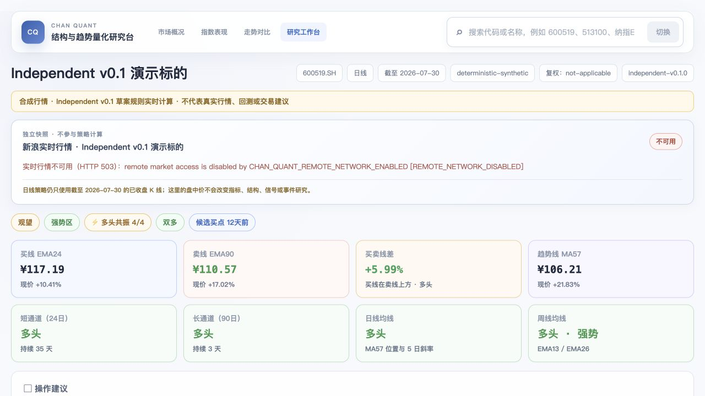

# Chan Quant

> **Experimental / Research Preview** · Strategy rules: **Independent v0.1 Draft**

**English summary:** Chan Quant is an auditable quantitative research workbench for market structure, trends, and time-correct strategy experiments. It is not a broker connection, trading bot, investment-advice service, or production market-data API. The default launcher accesses undocumented remote market endpoints; their contracts, availability, and usage rights are not granted by this repository's Apache-2.0 code license. Chinese documentation is normative.

Chan Quant 是一个结构与趋势量化研究台。它把严格三 K 分型、简化笔、均线、Donchian 通道、多周期状态和候选信号转换为可复现、可审计且不使用未来数据的计算结果。

当前策略版本为 **Independent v0.1 草案**。它是本项目独立选择的一套工程规则，不声称是“标准”或“正统”缠论。系统仍是研究与审计工具，不提供实盘交易能力。



> 上图使用确定性合成数据，只展示界面与计算链路，不代表真实市场表现。

## 一键启动

依赖已经安装后，在仓库根目录执行：

```bash
./start.sh
```

Windows PowerShell 用户可以直接执行：

```powershell
.\start.ps1
```

如果在 Windows 中使用 Bash，请优先使用 Git Bash。PowerShell 中的 `bash` 可能解析为 WSL 启动器；当 WSL 不可用或权限受限时，应改用 Git Bash 或上面的 `start.ps1`。

脚本会默认使用新浪日 K，同时启动后端和前端，并打印页面地址：

```text
http://127.0.0.1:5173/
```

> **网络访问提示：** `./start.sh` 和 `start.ps1` 默认启用远端访问。页面可能请求新浪未文档化 K 线、Quote、证券建议和批量行情端点，并读取上交所、深交所证券列表。仓库没有取得这些端点的固定字段合同、SLA、商业使用或再分发授权；使用者需要自行评估适用条款和法律边界。

根地址是市场概况首页，并在全局导航中提供紧凑证券搜索。可以输入股票 `600519.SH`、ETF `513100.SH`、六位代码或名称 `纳指ETF国泰`，选择沪深股票、ETF 或指数候选后进入研究 Dashboard；完整居中搜索页保留在 `/search`，Dashboard 顶部可以继续搜索并切换标的。终端按 `Ctrl+C` 会同时关闭两个进程。

首页还包含沪深 A 股远端市场温度。后端运行时读取上交所、深交所官方股票列表，再分批读取新浪逐证券行情并复算涨跌分布；不需要本地市场温度数据包。远端合同漂移、日期错配或覆盖不足时显示拒绝原因，不会使用截图数字、演示值或未标记的旧值。

固定宽基指数表现页位于：

```text
http://127.0.0.1:5173/indices
```

该页面默认以最近一年展示上证指数、深证成指、创业板指、沪深300、中证500、中证1000、科创50和上证50，并支持近 3 个月、近 6 个月、今年以来与自定义日期。起始价、区间末收盘、上一交易日涨幅、累计收益和最大回撤复用后端多标的比较结果；当前行情和当日涨跌来自独立 Quote，不参与历史指标计算。单个历史序列或行情失败不会清空其他卡片。当前已核验身份和比较合同只覆盖沪深规范代码，不展示未经验证的港股指数或指数市盈率。

也可以直接打开规范代码 URL：

```text
http://127.0.0.1:5173/?symbol=600519.SH
```

多标的日 K 走势对比页位于：

```text
http://127.0.0.1:5173/compare
```

该页面支持选择 2–8 个沪深标的，可快速装载经过身份核验的宽基指数 preset，以及按中证指数有限公司同日官方权重表和成分文件固化的行业/主题“前 8 权重”观察组；后者会显示来源指数、成员日期和身份确认日期，并明确不是完整指数或官方加权组合。当前组合也可保存为浏览器本地自定义板块。后端在共同覆盖区间内对齐日期，计算起始价、区间末收盘、上一交易日涨幅、归一化收益、累计收益和最大回撤；缺失交易日保持为空，不做静默填充。成功历史序列会并列显示独立 Quote 快照，逐标的行情失败不会清空历史结果，盘中价也不参与历史指标计算。当前多标的端点只支持启动脚本默认的新浪候选日 K 模式；未文档化数据源和复权口径风险会逐标的显示。

脚本不会自动安装依赖；首次运行仍需按照下一节分别执行 `uv sync --all-groups` 和 `npm ci`。

## 本地运行

启动 API。未配置行情文件时，后端使用确定性合成数据，并在响应和页面中明确标记：

```bash
cd backend
uv sync --all-groups
uv run uvicorn chan_quant.api.app:app --host 127.0.0.1 --port 8000
```

另开一个终端启动页面：

```bash
cd frontend
npm ci
npm run dev -- --host 127.0.0.1
```

打开 `http://127.0.0.1:5173/`。

### 完全禁用远端市场访问

默认启动行为保持远端访问开启。需要确定性离线 Dashboard、CI 或受限环境时，可以同时选择合成数据并关闭所有运行时远端市场 API：

```bash
cd backend
CHAN_QUANT_DATA_SOURCE=synthetic \
CHAN_QUANT_REMOTE_NETWORK_ENABLED=false \
uv run uvicorn chan_quant.api.app:app --host 127.0.0.1 --port 8000
```

关闭后，合成 Dashboard 仍可使用；证券搜索、身份、Quote、多标的比较和市场温度等只支持远端的端点会返回带 `REMOTE_NETWORK_DISABLED` reason code 的 HTTP `503`，不会回退到旧缓存或伪造数据。支持的配置名见 [`.env.example`](.env.example)。项目不会自动读取 `.env`；示例文件只记录安全配置合同。

### 使用本地 CSV

CSV 至少需要 `trade_date`（或 `date`）、`open`、`high`、`low`、`close`、`volume` 六列，可选 `amount`。Independent v0.1 的 EMA90 预热要求至少 92 根有效日 K：

```bash
cd backend
CHAN_QUANT_CSV_PATH=/absolute/path/to/bars.csv \
CHAN_QUANT_ADJUSTMENT=qfq \
CHAN_QUANT_INSTRUMENT_NAME='研究标的' \
uv run uvicorn chan_quant.api.app:app --host 127.0.0.1 --port 8000
```

`CHAN_QUANT_ADJUSTMENT` 只记录数据提供方声明的复权口径，程序不会自行推断或复权。接入 CSV 后 `is_mock=false`，但策略规则状态仍为 `DRAFT`，不能据此宣称已经验证有效。

### 使用可审计历史行情快照

当研究结果需要绑定到一份不可变的本地输入时，使用仓库外的快照目录：

```text
/absolute/path/to/market-snapshot/
├── manifest.json
└── bars.csv
```

`manifest.json` 显式声明标的、数据提供方、复权口径、获取时间、日期范围、K 线根数和 `bars.csv` 的 SHA-256。启动时后端会先验证哈希、标的、周期、日期范围、根数和 CSV 结构，任一不一致都返回 `422`，不会静默降级到新浪、普通 CSV 或合成数据：

```bash
cd backend
CHAN_QUANT_DATA_SOURCE=snapshot \
CHAN_QUANT_DATA_PACKAGE_PATH=/absolute/path/to/market-snapshot \
uv run uvicorn chan_quant.api.app:app --host 127.0.0.1 --port 8000
```

通过完整性检查后，Dashboard 会显示数据集 ID、提供方、日期范围、获取时间、复权依据、哈希状态和质量警告。`provider-declared` 只表示复权口径来自提供方声明，仍会标记为 `WARNING`；文件完整不代表复权经济含义或策略有效性已经验证。

数据包格式、manifest 示例、错误代码和生成 SHA-256 的方法见 `docs/market-snapshot.md`。行情数据、授权材料和凭证不得提交到 Git。

### 使用远端沪深 A 股市场温度

`./start.sh` 默认启用远端市场温度，不需要额外环境变量。后端读取上交所主板、科创板与深交所主板、创业板官方列表，再按最多 100 个代码一批读取新浪行情；北交所、B 股、基金、债券和指数不进入分母。

首次请求会访问远端，成功结果只在进程内缓存 5 分钟。页面“刷新”使用 `refresh=true` 强制重新读取；失败不会回退到缓存旧值。结果固定标记为 `mode=OBSERVED`，并显示 `REMOTE_OBSERVATION_NOT_AUDITABLE` 与 `SINA_UNDOCUMENTED_SOURCE` 风险，因为运行时没有保存逐批原始证据，新浪端点也没有公开字段合同、SLA 或授权保证。

涨、跌、平、12 个非零分桶、覆盖率和质量状态仍全部由 Python 后端计算。完整合同见 `docs/data-contract.md`，数据源研究及产品决策边界见 `docs/a-share-market-breadth-research.md`。

### 可选离线市场温度审计工具

如果需要保存原始证据用于离线复查，可以使用实验性的新浪日终导入器生成 `market-breadth-package-v0.2`。该包不再是首页运行依赖；命令只允许本地、低频、显式执行。批次大小必须先在真实开市日做有界合同探测，且运行时必须确认新浪端点未文档化：

```bash
cd backend
uv run python -m chan_quant.importers.sina_market_breadth \
  --session-date YYYY-MM-DD \
  --universe-csv /absolute/path/to/universe.csv \
  --universe-id official-sh-sz-YYYY-MM-DD \
  --universe-source 'SSE and SZSE official same-session exports' \
  --output-root /absolute/path/to/market-breadth \
  --batch-size <validated-size> \
  --acknowledge-undocumented-sina
```

导入器保存每个新浪原始批次及 SHA-256，只在完整包能重新通过后端校验时原子更新 `current`。这些证据不构成新浪字段承诺、SLA 或使用授权，`current` 也不会被运行中的页面自动读取。完整输入合同、错误行为和验收门槛见 [`docs/sina-market-breadth-importer.md`](docs/sina-market-breadth-importer.md)。

### 使用新浪财经候选 K 线源

新浪端点目前不需要 Token，但没有公开字段合同、复权说明或 SLA。本项目只从 Python 后端低频访问日 K 和单标的实时快照；实时快照使用独立接口和页面区域，**不进入策略链路**：

```bash
cd backend
CHAN_QUANT_DATA_SOURCE=sina \
CHAN_QUANT_SINA_DATALEN=2000 \
uv run uvicorn chan_quant.api.app:app --host 127.0.0.1 --port 8000
```

前端启动后可以打开完整搜索页：

```text
http://127.0.0.1:5173/search
```

标的名称匹配通过后端低频访问新浪未文档化建议端点，只用于选择标的，不生成策略结论。当前现场支持新浪类别 `11` 和 ETF 类别 `203`；类别 `11` 可能同时出现股票与指数别名，因此不会被强行标记为股票。规范代码可以直接进入；六位代码可能同时对应不同市场，因此页面会展示候选项供用户明确选择。

新浪模式只支持 `NNNNNN.SZ` 和 `NNNNNN.SH`。股票/未知类别响应会明确标记：

```text
data_source = sina-undocumented-kline
adjustment = unadjusted-observed
strategy.rule_status = DRAFT
```

`unadjusted-observed` 表示三个标的的除权窗口在 **2026-07-31** 的现场核验中与原始未复权 OHLC 一致，**不是**新浪提供的固定数据合同。除权除息仍会形成机械跳空，影响均线、通道、分型与事件收益。现场证据、审计命令、访问限制和使用边界见 `docs/sina-data-source.md` 与 `docs/sina-adjustment-research.md`。

ETF 返回 `asset_type=ETF`、`price_precision=3` 和 `adjustment=unspecified`。这表示行情链路能够读取 ETF，但尚未完成该 ETF 的复权、分红和份额折算口径审计；页面会显示独立风险警告，不能把三只股票样本的审计结论外推到 ETF。

### 独立实时行情

无论 Dashboard 使用合成数据、CSV 还是新浪日 K，规范沪深代码的页面都会通过后端独立访问：

```http
GET /api/v1/instruments/000001.SZ/quote
```

前端每 8 秒低频轮询；页面隐藏时暂停，重新可见时立即刷新。实时区域显示最新价、涨跌、开高低、成交量、行情时间、接收时间、数据源和 `实时/延迟/已收盘/不可用` 状态。上游失败只会让实时区域进入不可用状态，不会阻断 Dashboard。

`quote_at` 来自新浪响应，`received_at` 是后端接收时间。两者不得互相替代。实时价不会写入日 K，也不会改变 Independent v0.1 的 EMA、Donchian 通道、分型、简化笔、候选信号或事件研究。

## 验证

```bash
cd backend
uv run ruff check .
uv run pytest -q

cd ../frontend
npm test
npm run build
```

规则口径、数据合同、架构和产品边界见 `docs/`。

## 边界

- 研究和可视化优先，不连接券商或自动下单。
- 策略事件分别记录结构时间、确认时间与最早可执行时间。
- 页面展示与策略计算分离，前端不得重新实现交易规则。
- 合成数据上的信号数量和事件统计只验证计算链路，不代表真实市场表现。
- 新浪实时快照是未文档化 HTTP 端点的低频展示，不是 WebSocket、交易行情 SLA 或实盘性能证据。
- 新浪标的名称建议同样是未文档化候选接口；类别 `203` 只是在 2026-07-31 ETF 样本中的现场观察，不是正式证券主数据合同或全市场扫描能力。
- 市场温度是带显式风险标记的远端观测，不是可审计快照、交易级盘中全市场能力或正式行情服务。
- 可审计快照只验证本地文件、manifest 与数据结构的一致性；提供方授权和复权经济含义仍需独立证据。
- 匿名可访问不等于获得商业使用、再分发或稳定服务授权。
- 当前没有交易成本、滑点、涨跌停、停牌、分红处理或组合资金曲线。
- 行情、凭证、API Token 与本地缓存不提交到 Git。

## 参与和安全

- 贡献范围、验证方式和数据边界见 [`CONTRIBUTING.md`](CONTRIBUTING.md)。
- 安全漏洞请通过 GitHub Private Vulnerability Reporting 私密提交，见 [`SECURITY.md`](SECURITY.md)。
- 项目选择性处理 Issue 和 Pull Request，不承诺响应或支持时限。

## 许可证

代码以 [Apache License 2.0](LICENSE) 发布，版权所有 © 2026 ywu73。

该代码许可证不授予任何第三方行情、指数、交易所文件、网站内容或接口的访问、复制、商业使用和再分发权利。提供方端点能够匿名访问，不等于获得相应授权。
